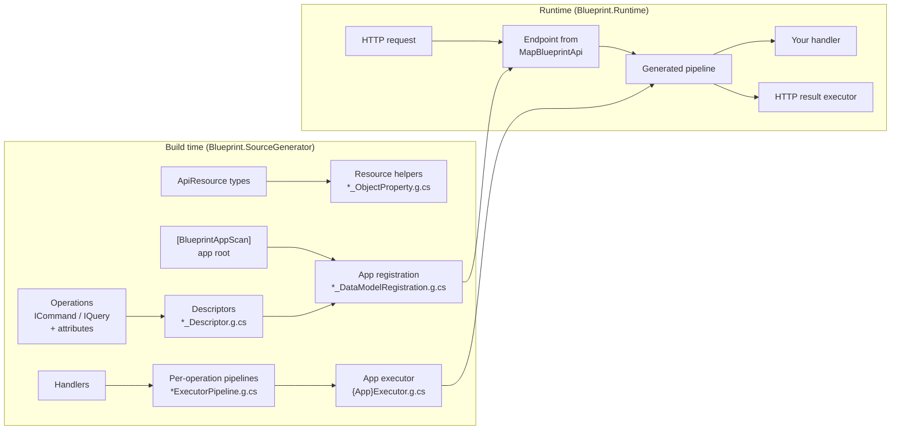

# Blueprint

Blueprint is a .NET framework for building HTTP APIs out of **operations**: small classes that each describe one
command or query. You declare what an operation is: its route, inputs, validation, authorisation and possible results.
Blueprint's Roslyn source generator turns those declarations into compiled code at build time. That code includes the
endpoint wiring, the request binding, the execution pipeline, the HATEOAS links and an OpenAPI document.

There is no reflection-driven discovery at start-up and no runtime scanning. If something is wrong with the shape of
your API, such as a route placeholder with no matching property or a response type the serialiser cannot handle, the
build fails with a diagnostic that points at the line.

```csharp
[SelfLink(typeof(GreetingApiResource), "/greetings/{Name}")]
[AllowAnonymous]
public partial class GetGreetingQuery : IQuery<GreetingApiResource>
{
    public required string Name { get; set; }
}

public class GetGreetingQueryHandler
{
    public GreetingApiResource Handle(GetGreetingQuery query) =>
        new() { Name = query.Name, Message = $"Hello, {query.Name}!" };
}
```

```http
GET /api/greetings/Ada

200 OK
{"name":"Ada","message":"Hello, Ada!","$object":"greeting","$links":{"self":{"href":"http://localhost:5000/api/greetings/Ada","type":null}},"$partial":false}
```

## Contents

- [Why Blueprint](#why-blueprint)
- [Packages](#packages)
- [Installation](#installation)
- [Getting started](#getting-started)
- [How it works](#how-it-works)
- [Writing operations](#writing-operations)
- [Results and HTTP responses](#results-and-http-responses)
- [Validation](#validation)
- [Authentication and authorisation](#authentication-and-authorisation)
- [Resources and links](#resources-and-links)
- [Serialisation](#serialisation)
- [OpenAPI](#openapi)
- [Cross-cutting services](#cross-cutting-services)
- [Observability](#observability)
- [Compile-time diagnostics](#compile-time-diagnostics)
- [Testing](#testing)
- [Further documentation](#further-documentation)
- [Building from source](#building-from-source)
- [Licence](#licence)

## Why Blueprint

- **Operations, not controllers.** Each endpoint is a class that states its own contract. Handlers are plain methods
  with their dependencies injected. There is no controller base class and no attribute routing spread across files.
- **Compile-time, not start-up time.** Operation descriptors, the app's operation registry, and one execution
  pipeline per operation are all generated source. At runtime they are simply called.
- **Mistakes fail the build.** About a hundred diagnostics cover route templates, handler signatures, result
  contracts, authorisation declarations, validation attributes and serialiser coverage. The missing-`partial`
  diagnostics (`BP001`, `BP002`, `BP005`, `BP104`) also come with an IDE code fix that adds it.
- **AOT- and trimming-friendly.** `Blueprint.Runtime` is marked `IsAotCompatible` and `IsTrimmable`. Serialisation
  goes through a `System.Text.Json` source-generated context that your app owns.
- **Hypermedia built in.** Responses are resources with `$object`, `$links` and `$partial`. Links are generated from
  the routes you declare, and the generator checks every placeholder at build time.
- **OpenAPI from the same model.** The document is rendered from the generated descriptors. It cannot drift from
  what the endpoints actually do.
- **Observable by default.** Every operation runs inside an `Activity` on the `Blueprint` activity source. Its
  status and any exception are recorded in OpenTelemetry-compatible form, along with audit events when an audit
  sink is registered.

## Packages

| Package | What it contains |
| --- | --- |
| `Blueprint.Runtime.Model` | The contracts: `IOperation`, `ICommand`, `IQuery`, `BlueprintApp`, `ApiResource`, `Results<T1, T2>`, and the attributes you put on operations. |
| `Blueprint.Runtime` | The runtime: the semantic result types (`OkResult<T>` and the rest), the executor that runs the generated pipelines, `AddBlueprintApi` / `MapBlueprintApi`, HTTP result translation and OpenAPI rendering. Depends on `Blueprint.Runtime.Model`. |
| `Blueprint.SourceGenerator` | The Roslyn source generator, plus the IDE code fix for a missing `partial`. It is an analyzer-only package, so reference it with `PrivateAssets="all"`. |
| `Blueprint.HttpClient` | `BlueprintHttpClient<TApp>`, a typed client that calls another Blueprint API using its operation types. |
| `Blueprint.Testing` | In-memory and full-HTTP test hosts, task collectors and result assertions. |
| `Blueprint.Marten` | A Marten `IUnitOfWork`, plus domain-event dispatch from Marten sessions. |
| `Blueprint.Rebus` | Delivers Rebus messages through Blueprint pipelines, with a transaction scope and an optional outbox. |
| `Blueprint.Marten.Rebus` | Publishes Marten domain events to Rebus. |
| `Blueprint.Hangfire` | Background tasks and recurring tasks on Hangfire. |
| `Blueprint.Testing.Marten` | Marten fixtures for `Blueprint.Testing`. |

Every package targets `net10.0`, apart from the generator, which targets `netstandard2.0` as all Roslyn components
must.

## Installation

> **Package feed.** Releases are currently published to GitHub Packages
> (`https://nuget.pkg.github.com/Symprex/index.json`), not nuget.org. GitHub Packages requires authentication
> even for public packages: add the source with a GitHub token that has `read:packages`. Publishing to nuget.org is
> planned. Until it happens, the `dotnet add package` commands below need that source configured.
>
> Several `Blueprint.*` IDs on nuget.org (for example `Blueprint.Http` 0.8.x) belong to an earlier, reflection-based
> version of this framework. If you configure both feeds, map `Blueprint` and `Blueprint.*` to the GitHub source with
> [package source mapping](https://learn.microsoft.com/nuget/consume-packages/package-source-mapping).

```powershell
dotnet add package Blueprint.Runtime
dotnet add package Blueprint.SourceGenerator
```

The generator only needs to be a compile-time dependency:

```xml
<ItemGroup>
  <PackageReference Include="Blueprint.Runtime" Version="1.0.7" />
  <PackageReference Include="Blueprint.SourceGenerator" Version="1.0.7" PrivateAssets="all" />
</ItemGroup>
```

You need the .NET 10 SDK.

## Getting started

This is a complete, runnable API. It is a single ASP.NET Core project (`Microsoft.NET.Sdk.Web`) with the two package
references above.

**`Api.cs`**

```csharp
using System.ComponentModel.DataAnnotations;
using System.Text.Json.Serialization;
using Blueprint.Model;
using Blueprint.Model.Attributes;
using Microsoft.AspNetCore.Mvc;

namespace Greetings;

// A query: GET by default. The route placeholder binds to the Name property.
[SelfLink(typeof(GreetingApiResource), "/greetings/{Name}")]
[AllowAnonymous]
public partial class GetGreetingQuery : IQuery<GreetingApiResource>
{
    public required string Name { get; set; }
}

// A command: POST by default. Its properties bind from the JSON body. This one has an
// inline handler, a Handle method on the operation itself.
[RootLink("/greetings")]
[AllowAnonymous]
public partial class CreateGreetingCommand : ICommand<GreetingApiResource>
{
    [Required]
    [MaxLength(20)]
    public string? Name { get; set; }

    public GreetingApiResource Handle() => new() { Name = this.Name!, Message = $"Hello, {this.Name}!" };
}

// The response. ApiResource adds $object, $links and $partial.
public partial class GreetingApiResource : ApiResource
{
    public required string Name { get; init; }

    public required string Message { get; init; }
}

// An external handler: any class with a Handle/HandleAsync/Invoke/InvokeAsync method whose
// first parameter is the operation. Its other parameters are resolved for you (see "Handlers").
public class GetGreetingQueryHandler
{
    public GreetingApiResource Handle(GetGreetingQuery query) =>
        new() { Name = query.Name, Message = $"Hello, {query.Name}!" };
}

// The app root. The generator finds every operation in this assembly and generates
// GreetingsAppExecutor alongside it.
[BlueprintAppScan]
[BlueprintAppSerializerContext(JsonSerializerContextType = typeof(GreetingsJsonContext))]
public partial class GreetingsApp : BlueprintApp;

// The app owns serialisation. The build fails (BP006) if a response type is missing here.
[JsonSerializable(typeof(GreetingApiResource))]
[JsonSerializable(typeof(ProblemDetails))]
[JsonSerializable(typeof(ValidationProblemDetails))]
public partial class GreetingsJsonContext : JsonSerializerContext;
```

**`Program.cs`**

```csharp
using Greetings;

var builder = WebApplication.CreateBuilder(args);

builder.Services.AddBlueprintApi<GreetingsApp, GreetingsAppExecutor>();

var app = builder.Build();

app.MapBlueprintApi<GreetingsApp, GreetingsAppExecutor>("api/");

app.Run();
```

Run it, and:

| Request | Response |
| --- | --- |
| `GET /api/greetings/Ada` | `200` with `{"name":"Ada","message":"Hello, Ada!","$object":"greeting","$links":{"self":{"href":".../api/greetings/Ada",...}},"$partial":false}` |
| `POST /api/greetings` with `{"name":"Grace"}` | `200` with the new greeting and its `self` link |
| `POST /api/greetings` with `{}` | `422` problem details: `"errors":{"Name":["The Name field is required."]}` |
| `GET /api/` | `200` root document listing every root link: `{"$object":"root","$links":{"CreateGreeting":...}}` |
| `GET /api/.blueprint/openapi.json` | The OpenAPI 3.0 document for both operations |

Remove `[AllowAnonymous]` from the command and the same `POST` returns `401`: Blueprint refuses anonymous callers
unless an operation says otherwise.

## How it works

Blueprint does its work in two phases. At build time, the source generator reads your operations and writes the
code that runs them. At runtime, that generated code is called directly.



### At build time

The generator is an incremental Roslyn generator. Most of its output appears only when the type that triggers it is
marked `partial`, and it reports a diagnostic when that modifier is missing.

1. **Descriptors.** Each operation class gets a generated `static ApiOperationDescriptor Configure()`. The descriptor
   carries everything known about the operation: its name, HTTP methods and routes, how each property binds, its
   validation, its authorisation requirements, its declared results and their HTTP status codes, and the links it
   contributes. String-shaped inputs such as route templates are checked against real symbols at this stage. A
   placeholder with no matching property is a build error, not a runtime 404.
2. **Resources.** Each `ApiResource` subclass gets its `$object` discriminator generated. `GreetingApiResource`
   becomes `"greeting"`.
3. **App registration.** Each `partial` class marked `[BlueprintAppScan]` gets a generated constructor that
   registers the descriptor of every operation it scans. The default scan is the app's own assembly.
   `FromAssemblyOf = typeof(SomeOperation)` scans a contract assembly instead. This is also where the generator
   checks app-wide rules: duplicate operation names, and whether the app's serialiser context covers every response
   body.
4. **Pipelines and the executor.** For every operation, the generator finds exactly one handler and analyses its
   parameters. It then writes a pipeline: a straight-line method that runs each stage in order, with no middleware
   lookup and no reflection. Finally it writes `{App}Executor`, which maps each operation type to its pipeline.

To see the generated code, set `EmitCompilerGeneratedFiles` to `true` in your project and look under
`obj/.../generated/`, or expand **Dependencies → Analyzers → Blueprint.SourceGenerator** in your IDE.

### At runtime

`AddBlueprintApi<TApp, TExec>()` registers the app (the registry of descriptors) and the generated executor.
`MapBlueprintApi<TApp, TExec>(basePath)` then adds an ASP.NET Core endpoint for every route on every HTTP-exposed
operation. It also adds the root document at `basePath`, and the OpenAPI document at
`basePath/.blueprint/openapi.json`, which is rendered once at start-up.

A request then runs through that operation's generated pipeline:

1. **Bind.** Route values, the query string, headers, cookies and the JSON body are bound onto a new operation
   instance. The binding code is generated, so it knows each property's source and type ahead of time. For example,
   the JSON body is read with a `Utf8JsonReader` loop that matches each property name directly.
2. **Resolve context.** If configured, the tenant is resolved from the caller's claims, and the user's authorisation
   context is loaded.
3. **Authenticate and authorise.** The caller is checked against the operation's declarations: `[AllowAnonymous]`,
   `[MustBeAuthenticated]` or `[Resource]`. Your registered authorisers are then consulted.
4. **Validate.** The operation's validation attributes run. Common attributes are compiled into direct inline checks.
   Any failure ends the request with a `422`.
5. **Handle.** Your handler is called. Its dependencies come from the request's DI scope.
6. **Post-execution, on success only.** In this order:
   1. The unit of work is saved.
   2. The message outbox is committed.
   3. The audit sinks are called.
   4. Background tasks queued by the handler are flushed.
   5. Links are added to any returned resources.
7. **Translate the result.** The HTTP result executor writes the response: the status code for the result type,
   the JSON body through your serialiser context, and `Location` and `ETag` headers where they apply.

The whole pipeline runs inside an `Activity`. Exceptions are caught by a generated exception shell and translated:
validation exceptions become `422`, an `ApiException` becomes its own status code, and anything else becomes a `500`.
Each of these is returned as problem details.

## Writing operations

An operation is a class implementing `ICommand`, `ICommand<TResult>` or `IQuery<TResult>`. Mark it `partial` so the
generator can add its descriptor.

| Interface | Default HTTP method | Default binding for non-route properties |
| --- | --- | --- |
| `IQuery<T>` | `GET` | Query string |
| `ICommand` / `ICommand<T>` | `POST` | JSON body |

Override the method with `[HttpGet]`, `[HttpPost]`, `[HttpPut]`, `[HttpPatch]`, `[HttpDelete]` or
`[HttpMethod("...")]`. Properties whose names match a route placeholder always bind from the route. You can bind any
property explicitly with `[FromRoute]`, `[FromQuery]`, `[FromHeader("X-Name")]`, `[FromCookie("name")]` or
`[FromBody]`.

### Handlers

A handler is a method named `Handle`, `HandleAsync`, `Invoke` or `InvokeAsync`. It can live in one of two places:

- **Inline**, on the operation class itself.
- **External**, on a non-static class whose method takes the operation as its first parameter. The class's
  constructor dependencies come from DI.

The method's other parameters are resolved by type:

- A `CancellationToken` is the request's cancellation token.
- A `ClaimsPrincipal` is the caller.
- An `ApiOperationContext` is the operation's execution context.
- Anything else is resolved from DI.

Each operation must have exactly one handler. None is `BP100`, and more than one is `BP101`. The handler must be in
the assembly being compiled.

Operations can live in a separate contract assembly, which a client can then share, but their handlers must live in
the app. If you split them this way, reference `Blueprint.SourceGenerator` from **both** projects: the contract
project generates the descriptors, and the app project generates the registration, pipelines and executor.

A handler can return any of the following:

- **A plain value.** This becomes a `200` with that value as the body.
- **`void` or `Task`.** This becomes an empty `200`.
- **A specific `OperationResult`.** This is used as is (see below).

### Operation names

An operation's name, which is also its OpenAPI `operationId`, is its type name with `Query` and `Command` removed.
So `GetGreetingQuery` becomes `GetGreeting`. If an app's operations share a prefix that should not appear in its
API, declare `[BlueprintAppOperationNames(Remove = "Portal")]` on the app root. Two operations that would end up
with the same name fail the build.

## Results and HTTP responses

Use a specific result type when a status code matters, and `Results<T1, T2>` when an operation has two possible
outcomes:

```csharp
[SelfLink(typeof(TemplateApiResource), "/templates/{Id}")]
public partial class GetTemplateQuery : IQuery<Results<OkResult<TemplateApiResource>, NotFoundResult<TemplateApiResource>>>
{
    public required string Id { get; set; }
}
```

| Result | Status | Body |
| --- | --- | --- |
| `OkResult<T>` | 200 | JSON |
| `CreatedResult<T>` | 201 | JSON, plus a `Location` header from the resource's self link |
| `AcceptedResult<T>` | 202 | JSON |
| `NotFoundResult<T>` | 404 | JSON |
| `ConflictResult<T>` | 409 | JSON |
| `ResourceEventResult<T>` | 201 / 200 / 204 for created / updated / deleted | An event: `$object: "event"`, `eventId`, `changeType`, `created`, `resourceObject`, `href` and the resource as `data`. None on 204. A 201 also gets a `Location` header. |
| `KeyOnlyResourceEventResult` | 201 / 200 / 204 | None |
| `NoResultOperationResult` | 200 | None |
| `HttpNoContentResult` | 204 | None |
| `PlainTextResult` | 200 (configurable) | `text/plain` |
| `RedirectResult` | 302 (configurable) | None, plus a `Location` header |
| `FileStreamResult` | 200 | The stream, with `Content-Disposition` when a file name is set |
| `NotModifiedResult<T>` | 304 | None (see `ETagger` and `AddETagSupport()`) |
| Validation failure | 422 | `ValidationProblemDetails` |
| Unhandled exception | 500 | `ProblemDetails`, without the exception details unless `ExposeExceptionDetailsInErrorResponses` is set |

The build checks every declared result contract against what the HTTP host can actually express. For example, a
union whose two members would both produce a `200` JSON body cannot be told apart by a client, so it is rejected
(`BP109`/`BP110`).

When a result type is impractical, for instance deep inside a domain service, throw an `ApiException`, or one of its
subclasses `NotFoundException`, `ConflictException`, `BadRequestException` or `ForbiddenException`. It is translated
to problem details with its own status code.

## Validation

Put standard `System.ComponentModel.DataAnnotations` attributes on operation properties. The generator compiles the
common ones into inline checks: `Required`, `MaxLength`, `MinLength`, `StringLength`, `EmailAddress`, `Phone`, `Url`,
`Range`, `RegularExpression`, `AllowedValues` and `DeniedValues`. Other attributes, and `IValidatableObject`, run
through the standard validator.

`Blueprint.Validation` adds cross-property and collection attributes: `GreaterThanProperty`, `LessThanProperty`,
`GreaterThan`, `LessThan`, `RequiredIf`, `RequiredIfNot`, `RequiredItemsIf`, `RequiredItemsIfNot`, `NotAllowedIf`,
`NotEmptyList` and `MaxItemsList`. Their property references are checked at build time.

Validation attributes are also projected into the OpenAPI schema. For example, `MaxLength` becomes `maxLength`,
`Range` becomes `minimum`/`maximum`, `RegularExpression` becomes `pattern`, and `EmailAddress` becomes
`format: email`.

## Authentication and authorisation

Blueprint reads the caller from `HttpContext.User`. Configure ASP.NET Core authentication as usual, with
`AddAuthentication(...)` and `app.UseAuthentication()` before the endpoints.

Every operation is authorised unless it opts out. Choose one declaration per operation:

| Declaration | Meaning |
| --- | --- |
| `[AllowAnonymous]` | Anyone may call it. |
| `[MustBeAuthenticated]` | Any authenticated caller may call it. |
| `[Resource("template", "write")]` | The caller needs this noun/verb scope pair, as judged by your `IResourceAuthorizationProvider` (see below). Several `[Resource]` attributes mean "any of" these. Implies authentication. |
| `[FromResource(typeof(OtherOperation))]` | Use another operation's `[Resource]` pairs. |
| *(none)* | An anonymous caller is refused with `401`. An authenticated caller is checked by your registered authorisers. |

Scope pairs are decided by the `IResourceAuthorizationProvider`s you register. Blueprint ships one,
`ScopePairClaimAuthorizationProvider`, which matches the pairs against the caller's `scope` claims. A provider returns
an `ExecutionAllowed` decision, answered as an authoriser's is: its failure type selects `401` or `403`, its message
titles the response and its reason is only logged. Every registered provider must allow.

> **Register a provider if you use `[Resource]`.** Without one there is nothing to judge the scope pairs.
> `MapBlueprintApi` throws at start-up, naming the operations. If the operations run without it, in an in-memory test
> host for example, each is refused with a `403`. An app with no `[Resource]` operations needs no provider.

Business rules, such as "only the tenant's own users", go in `IOperationAuthoriser` / `IApiAuthoriser`
implementations. Link visibility can be filtered per resource, for example to hide an `archive` link on an
already-archived item. Conflicting declarations are build errors (`BPAU001`–`BPAU006`).

```csharp
builder.Services.AddBlueprintApi<MyApp, MyAppExecutor>(blueprint =>
{
    blueprint.AddResourceAuthorizationProvider<MyScopeAuthorizationProvider>();
    blueprint.AddOperationAuthoriser<TenantIsolationAuthoriser>();
    blueprint.AddUserAuthorisationContextFactory<MyUserContextFactory>();
});
```

## Resources and links

A response type that derives from `ApiResource` is written with three extra properties:

- `$object`: the generated type discriminator.
- `$links`: the resource's hypermedia links.
- `$partial`: whether this is a cut-down representation.

Links come from operations:

| Attribute | Effect |
| --- | --- |
| `[SelfLink(typeof(TResource), "/templates/{Id}")]` | This operation is the canonical `self` link for `TResource`. Placeholders are filled from the resource's properties. |
| `[Link(typeof(TResource), "/templates/{Id}/versions", Rel = "versions")]` | Adds a named link to every `TResource`. |
| `[RootLink("/templates")]` | A route with no resource. It is listed in the root document at `GET <basePath>`. |

Use `{OperationProperty:ResourceProperty}` when the names differ, for example `"/templates/{TemplateId:Id}"`. Every
placeholder is checked at build time against both the operation and the resource (`BPLG001`–`BPLG003`).

Add `Expandable<T>` properties, and an `IResourceExpander` registered with `AddResourceExpander<T>()`, to let clients
request related resources inline with `?expand=Owner`.

## Serialisation

Responses are written with `System.Text.Json` through a source-generated `JsonSerializerContext` that your app
declares on its root with `[BlueprintAppSerializerContext]`. The generator works out every body type that any
operation can return and checks your context against that list:

- If the app has body-bearing responses but no context is declared, the build fails with `BP007`.
- If the context is missing a body type, the build fails with `BP006`, which names the type to add as
  `[JsonSerializable(typeof(...))]`.

JSON options such as the naming policy are set the usual way, with `[JsonSourceGenerationOptions]` on that context.

## OpenAPI

`MapBlueprintApi` serves an OpenAPI 3.0 document at `<basePath>/.blueprint/openapi.json`. It is built from the
generated descriptors, so it includes:

- every route and method,
- each parameter and its binding source,
- request and response schemas with their validation constraints,
- every declared result's status code,
- security requirements, derived from the authorisation attributes,
- tags (`[ApiOperations("Templates")]`, or else the namespace),
- `deprecated` for `[Obsolete]` operations,
- `[Description]` text and `[OpenApiExample]` values.

```csharp
app.MapBlueprintApi<MyApp, MyAppExecutor>(
    "api/",
    configureOpenApi: info =>
    {
        info.Title = "Template Management API";
        info.Version = "1.0.0";
    });
```

`MapBlueprintApi` also accepts ordered schema and operation processors, for adjustments the model cannot express.

## Cross-cutting services

Infrastructure is pluggable through `AddBlueprintApi`'s builder. Every seam is optional: if a service is not
registered, its pipeline step is skipped. The exception is the resource authorisation provider: an app with
`[Resource]` operations must register one (see [Authentication and authorisation](#authentication-and-authorisation)).

```csharp
builder.Services.AddBlueprintApi<MyApp, MyAppExecutor>(blueprint =>
{
    blueprint.AddUnitOfWork<MyUnitOfWork>();                       // saved after a successful handler
    blueprint.AddBackgroundTaskScheduler<MyTaskScheduler>();       // tasks flushed only on success
    blueprint.AddAuditSink<MyAuditSink>();                         // per-operation audit events
    blueprint.AddResourceEventAuditSink<MyResourceEventAuditSink>();
    blueprint.AddMessageOutbox<MyOutbox>();
    blueprint.AddTenancy<AsyncLocalTenantAccessor, MyTenantResolver>();
    blueprint.AddResourceExpander<OwnerExpander>();
    blueprint.AddETagSupport();
    blueprint.ConfigureHttp(http =>
        http.ExposeExceptionDetailsInErrorResponses = builder.Environment.IsDevelopment());
});
```

Post-execution steps run in a fixed order, and only when the handler succeeds:

1. Save the unit of work.
2. Commit the message outbox.
3. Call the audit sinks.
4. Flush the background tasks.

So audits see committed state, and messages and tasks never go out for work that was rolled back. Opt an operation out of a step
with `[DoNotSaveChanges]`, `[DoNotAudit]` or `[DoNotRecordPerformanceMetrics]`. Mark properties `[Sensitive]` so audit
sinks can redact them.

**Background tasks** are operations that also implement `IBackgroundTask`. A handler enqueues one with
`IBackgroundTaskScheduler.Enqueue(...)`. The task runs later through its own generated pipeline, on Hangfire
(`Blueprint.Hangfire`) or any scheduler you provide.

**Messaging**: `Blueprint.Rebus` delivers Rebus messages through Blueprint pipelines. Each message gets a transaction
scope and the same post-execution steps. A handler can defer or forward the message it is handling.

## Observability

Every operation runs inside an `Activity` on the `Blueprint` activity source. To collect them:

```csharp
builder.Services.AddOpenTelemetry().WithTracing(tracing => tracing
    .AddSource(Blueprint.Diagnostics.BlueprintActivitySource.ActivitySourceName)
    .AddAspNetCoreInstrumentation());
```

Each span is named after the operation type plus `Pipeline`, for example `GetGreetingQueryPipeline`. Its status is
set through `otel.status_code`. A failure adds an exception event that follows OpenTelemetry's `exception.*`
conventions. When an `IAuditSink` is registered, the span also gets `blueprint.audit.started`/`succeeded`/`failed`
events tagged with `blueprint.operation.type`. `[DoNotRecordPerformanceMetrics]` turns the span off for an operation.
Pipeline logging uses `LoggerMessage.Define` delegates rather than string formatting.

In development, an app that sets `BlueprintHttpOptions.OperationsManifestResourceName` can also serve a generated
manifest of its operations as JSON, HTML or Markdown under `<basePath>/.blueprint/manifests/`. See [`docs/observability-and-dev-experience.md`](docs/observability-and-dev-experience.md).

## Compile-time diagnostics

Diagnostics are grouped by prefix. Each one names the symbol and location.

| Prefix | Area |
| --- | --- |
| `BP001`–`BP099` | App roots, `partial` requirements, serialiser coverage, operation names |
| `BP100`–`BP199` | Handlers, results and result unions |
| `BPLG` | Link and route templates |
| `BPAU` | Authorisation declarations |
| `BPV` | Validation attributes |
| `BPPO` | Property binding |
| `BPOA` | OpenAPI |
| `BPOD` | Host exposure (HTTP, tasks, messaging) |
| `BPRE`, `BPA`, `BPP`, `BPM`, `BPT` | Resource events, auditing, persistence, messaging, background tasks |
| `BPMIG` | Migration from the earlier, reflection-based Blueprint |

The full list is in [`docs/diagnostic-reference.md`](docs/diagnostic-reference.md).

## Testing

`Blueprint.Testing` provides two hosts:

- `BlueprintTestHost<TApp, TExec>` runs operations in memory, through their real generated pipelines, without
  HTTP.
- `BlueprintHttpTestHost<TApp, TExec>` runs the full HTTP stack on `TestServer`.

Both let you set the caller, tenant and services per test. The package also includes `BackgroundTaskCollector` and
result assertions such as `ShouldBeOk<T>()` and `ShouldBeValidationFailed()`.

## Further documentation

| Document | Read it for |
| --- | --- |
| [`docs/guiding-principles.md`](docs/guiding-principles.md) | The design rules behind the framework |
| [`docs/architecture.md`](docs/architecture.md) | The generator and runtime in depth, and the module extension seam |
| [`docs/authorization.md`](docs/authorization.md) | The authorisation model in full |
| [`docs/integration-packages.md`](docs/integration-packages.md) | Marten, Rebus, Hangfire, the HTTP client and testing |
| [`docs/diagnostic-reference.md`](docs/diagnostic-reference.md) | Every diagnostic ID |
| [`docs/deployment-and-operations.md`](docs/deployment-and-operations.md) | Middleware order, proxies, production settings |
| [`docs/consumer-migration-guide.md`](docs/consumer-migration-guide.md) | Moving an app from the earlier, reflection-based Blueprint |
| [`src/Blueprint.SourceGenerator.Sample`](src/Blueprint.SourceGenerator.Sample) | A larger sample app covering most features |

## Building from source

You need the .NET SDK pinned in `global.json`. Then, from a fresh clone:

```powershell
dotnet tool restore
dotnet husky install          # pre-commit hook: dotnet format on staged .cs files
dotnet build .\Blueprint.sln
dotnet test .\Blueprint.sln
```

- Generator snapshot baselines live under `src\Blueprint.SourceGenerator.Tests\Generators\*\Snapshots\`.
- `TestHelpers.Compile<T>()` checks that the generator's output is incrementally cacheable, as well as checking the
  output itself.
- Commits use conventional commit messages (`feat:`, `fix:`, `docs:`, `chore:`).
- A change that affects architecture, diagnostics or how Blueprint is consumed updates the relevant file in `docs/`
  in the same change. [`docs/README.md`](docs/README.md) explains how the docs are maintained.

## Licence

Blueprint is licensed under the [Apache License 2.0](https://www.apache.org/licenses/LICENSE-2.0). It succeeds the
earlier, reflection-based Blueprint ([barclayadam/blueprint](https://github.com/barclayadam/blueprint)), which is
also Apache 2.0.
